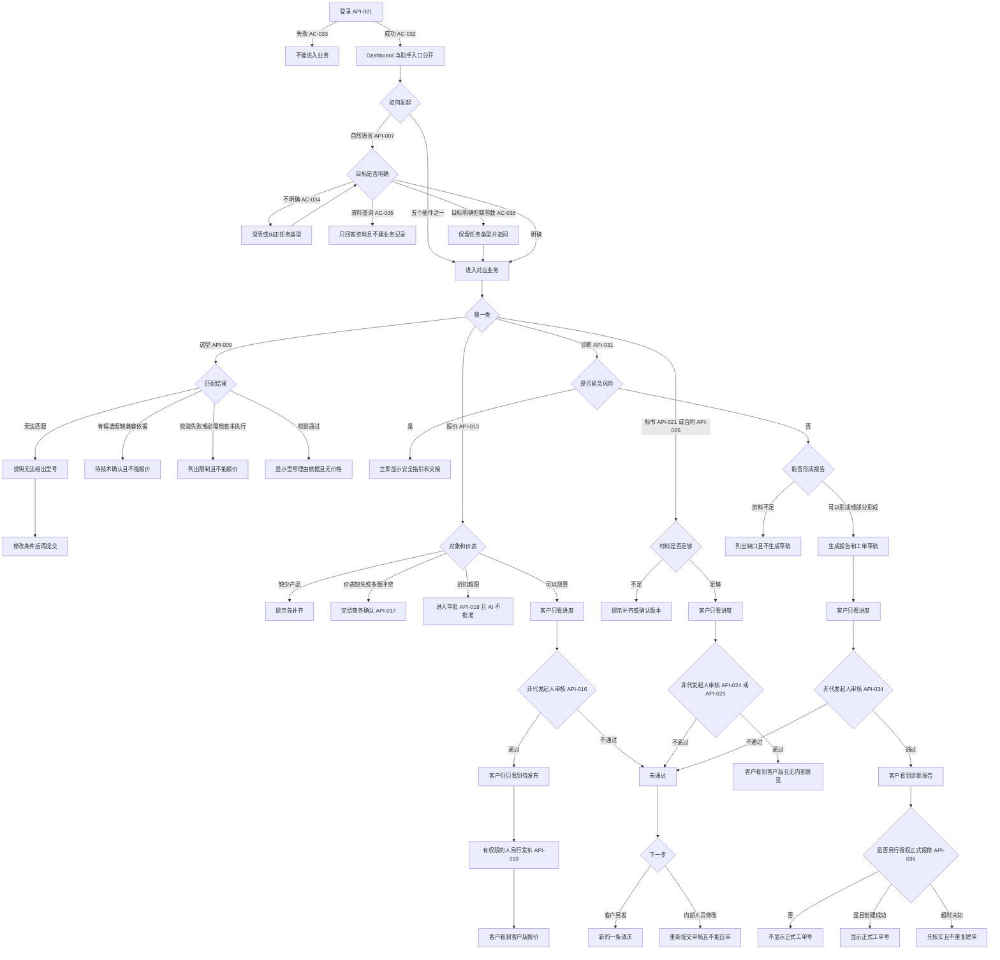
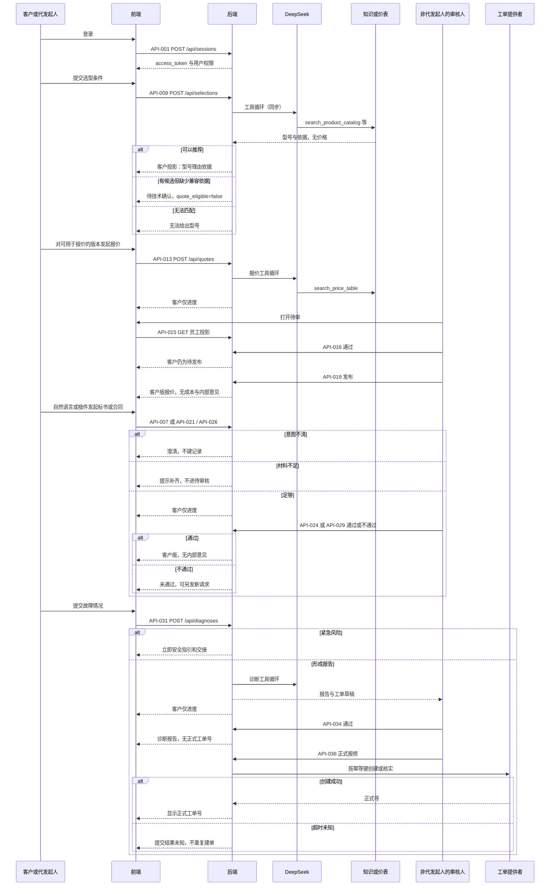

# 禾迈电力电子销售助手
status: Draft

2026-11-04 已确认的基线仍然有效，见下文「当前已确认基线」。2026-11-08 按 `20261104Latest` 做增量修订。本轮新增范围和无法消解的冲突标为待确认，确认前不覆盖已确认基线，也不把待确认项写成已确认。

## 用户目标与完整流程

终端客户，以及以普通企业客户身份使用标准版的经销商，在 Web 助手里完成销售链路和售后链路。销售链路按选型、方案报价、标书、合同推进；售后链路是故障诊断。内部销售或售前可以代指定客户发起，结果归该客户。现在这些工作靠人力按原有业务流程执行。目标是改由 AI 执行，再由有相应权限、且不是本次代发起人的禾迈员工审核。AI 不能自行批准。

输入框下方放 5 个插件：产品选型、方案报价、标书管理、合同管理、故障诊断。Dashboard 与业务入口分开。也可以直接输入自然语言发起任务。任务不明确时可以澄清，识别有误时可以纠正。知识问答、上传和历史会话不是单独的业务插件；上传只作为某次任务的输入，上传本身不等于授权执行附件里的业务动作。

直接对话还可以做资料查询。查询具体型号的参数、功能或资料时，只返回授权范围内的资料结果，不创建选型、报价、标书、合同或诊断记录。首版没有覆盖的查询，页面说明当前能做的五类业务，不假装已经查到。目标已经明确、只缺参数时，保留该任务类型并追问缺的字段，不把它说成意图不明。「上一版」「这套配置」必须对应唯一且已授权的客户、项目和版本；有多个候选时先确认。「先校验，通过后再报价」按先后依赖处理：先完成校验，报价等待校验结果；首版分步执行时告知用户，并保留后半句，不丢掉报价请求。「不要送审」「确认后再发布」不得触发送审或发布。用户纠正或否定时，以当前明确意图为准。从某个插件进入后，实际诉求变了，可以纠正或切换业务类型。

例如，客户要为一处电站选适用产品。提交使用条件后，可以看到推荐型号、推荐理由和依据，看不到价格。配套依据不足时，看到待技术确认，该版本不能直接拿去正式报价。再对可用于报价的配置版本发起报价，审核通过前只看到进度；审核通过后仍只看到进度，直到有发布权限的人另行发布，客户才看到客户版报价。标书和合同同样在审核通过前只显示进度。故障诊断每次形成报告时同时生成工单草稿；正式报修要另有授权，创建成功后才出现正式工单号。出现冒烟、异味、异常发热等紧急风险时，普通排查停止，安全指引和交接不等待普通报告审核。

2026-11-04 已确认的决策：

1. 首版使用 5 个插件，标书和合同纳入首版流程与验收。
2. 经销商可以普通企业客户身份使用标准版；经销商专属功能仍然延期。
3. 内部销售或售前可以代客户发起；审核权限与使用权限分开，代发起人不能审核自己发起的记录。
4. 报价批准后不立即对客户可见，须另行发布。
5. 每次形成诊断报告时生成工单草稿；正式报修另需授权。不采用「报告通过后自动正式报修」，因为它与「另需授权」冲突。
6. 客户不能在同一条已拒记录上修改重提，但可以另发一条新请求；有权限的内部人员可以修改后重新提交审核。

竞品比较于 2026-11-04 阅读官方页面。

- 利驰能源装备方案覆盖参数化选型、查价和智慧标书，并继续进入电气成套设计与制造。已读页面没有销售合同管理和售后故障诊断。来源：https://leadsoft.com.cn/index.php?catid=197
- 瑞云服务云覆盖制造业售后，新能源范围写明光伏、风电、储能。故障诊断、知识库、故障库、工单和工程师建议在官方页面中。已读页面没有销售选型、投标标书和销售合同的操作流程。来源：https://www.fscloud.com.cn/ 与 https://www.fscloud.com.cn/crm/IOT.html

已采用的结论：同一个助手里分成销售链路和售后链路。选型、报价、标书、合同和诊断都要落在禾迈自己的资料和规则上。不纳入识图、CAD、线束和母排制造，也不纳入上门派工、备件仓储和物联网预警。原始稿中的 Agent Prompt、JSON 示例和原型不作为已批准的首版需求。

## 本次范围

### 当前已确认基线

下文「客户」包括终端客户，以及以普通企业客户身份使用标准版的经销商。两者走同一套页面和验收，没有经销商专属菜单。

- 标准 Web 版。审核人是具备相应业务和项目权限的禾迈员工，具体岗位待配置／待确认。代发起人不能审核自己发起的那一条。
- 输入框下方 5 个插件：产品选型、方案报价、标书管理、合同管理、故障诊断。自然语言也能发起。
- Dashboard 与业务入口分开。
- 交付顺序是先选型与报价，再标书与合同，再故障诊断。
- 选型结果直接给客户看，其中不包含价格，并包含推荐理由、依据、关键配套校验和待确认项。
- 报价、标书、合同和诊断报告在审核通过前，客户只能看到进度。报价在审核通过后还要另行发布，发布前客户仍只看到进度。
- 客户版隐藏成本、利润、内部意见和无权查看的日志。
- 每次形成诊断报告（含部分报告）时生成工单草稿。正式工单号只有在另行授权并创建成功后才显示。
- 进度分为处理中、待审核、待技术确认、待商务确认、待发布、已发布、已通过、未通过、提交结果未知。不是每条任务都会出现全部进度。
- 客户之间的记录互相隔离。结果归属于被指定的客户；代发起不改变归属。
- 审核未通过后，客户不能在同一条上修改重提，可以另发一条新请求。有权限的内部人员可以修改该条并重新提交审核。重新提交的人不能审核这一次重新提交的内容；原代发起人不能审核或发布的限制仍然有效，不因刷新、退出重登或等待一段时间失效。
- 查看、修改、技术确认、商务确认、审核、发布、正式报修是不同权限。不能审核自己发起的记录，不等于不能查看。代发起人能看哪些内容，仍由他的项目和业务权限决定。
- 首版资料来自受控种子文件。能支持的产品、地区、价表和规则以种子实际覆盖为准。种子没有的条件走无法匹配、无法报价或待确认，不编造型号、价格或依据。
- 本系统创建的工单号只在本助手内有效，表示正式创建记录已成功。它不是外部售后系统的受理号，也不表示已经派工或有人接单。
- 模拟模式可以验收页面、权限和状态流转。真实生成质量要另有实际模型调用和有效资料，模拟通过不能写成真实模型通过。
- 知识库管理后台延期。供业务使用的种子资料仍须有来源、版本和有效性；过期、冲突或未授权的资料不能当成可用依据。
- 思考过程是给使用者看的业务步骤，不是隐藏日志。当前一版只做给公司内人员，他们能看到该次任务的全部思考过程。终端客户和经销商这一版不看这段过程。客户版仍隐藏成本、利润、内部意见，诊断页仍不向客户展示轮次和调用次数。

### 这一版界面只做内部人员

2026-11-09 用户确认：这一版只做内部人员使用端的界面，暂不制作终端客户和经销商的使用界面。2026-11-04 基线里「客户能看进度、发布后能看客户版」的规则保留，留到以后的客户界面。本版页面不提供客户或经销商登录后的任务发起和结果查看。

员工仍可代指定客户发起。采纳并归档成功后，结果归该客户。客户暂时没有自己的页面打开这些结果，所以本版不会把未发布内容展示给客户。

### 思考过程给谁看

2026-11-08 用户说明：思考过程先给用户看；当前一版先做给公司内人员，他们可以看到全部思考过程。

全部思考过程指这次任务实际走过的业务步骤：识别出的任务类型、绑定的客户和项目、用到的输入、每一项检查及结果、依据和缺口、为何停在当前状态、以及明确没有做的动作（不自行批准、发布、签章或正式报修）。诊断步骤里包含已经用掉的轮次和调用次数。这不是模型供应商的隐藏推理原文；对话模型仍不开启 thinking 扩展。

公司内人员看到这些步骤，不改变记录归属，也不因此获得审核或发布自己代发起记录的权力。终端客户和经销商仍只看各验收里已经允许的客户版内容。

2026-11-08 用户进一步确认展示时机：执行过程中显示「处理中」和当前业务步骤；本次执行结束或遇到阻塞后，按顺序一次展示已经发生的步骤、检查结果、依据、缺口和未执行项。这些步骤只给公司内人员。演示里可以使用预设步骤，但必须标明是演示，不表示真实模型或工具已经执行。

### 结果生成后再归档，归档不等于审批

2026-11-09 用户确认，替代 2026-11-08「归属必须在执行前确定」这一条。不送审、步骤时机和标书缺口仍按当时的确认。

- 五类业务发起时不强制选择客户和项目。用户可以直接选择意图、输入需求并执行。业务本身缺的参数仍要追问，例如报价缺地区时先追问地区，不生成报价。
- 未归档的结果只留在当前会话，不默认绑定客户或项目，也不向客户开放。纯资料查询和尚未进入执行的意图澄清不创建业务记录，也不计入有效业务任务。
- 引用已有配置、报价、合同或设备资料时，仍要核实唯一对象和查看权限。不能跨客户、跨项目混用。
- 可交付结果生成后，在结果下方询问是否采纳并归档，不使用弹窗。表单包含客户名称、地区、项目名称；对话里已经明确的信息自动带入，允许修改。项目可以明确选择「未分项目」。
- 只有用户点击「采纳并归档」并且保存成功，才记录一次采纳。归档关联本次任务、结果版本、客户、地区、项目和实际操作者。同一版本重复点击、刷新或再次打开不重复计数。失败时保留已填内容并提示重试，不计入采纳。成功后展示归属摘要，不能再靠归档改掉已有归属。
- 「暂不归档」保留会话结果，可以继续补充或调整。
- 归档只表示助手结果已保存。它不代替审核通过、报价发布、合同签署或正式报修，也不能把「校验通过」写成「业务已批准」。「已归档」单独作为保存标记，不替换原有进度。代发起人仍不能审核或发布自己的记录。助手结果的这次保存，不代替后面的标书提交归档，也不代替合同签署状态的手动更新。
- 演示可以展示完成率、端到端完成率、采纳率和满意度的口径。满意度只来自明确评价，不能用归档代替。员工代客户归档只记为员工采纳。不新增经营分析页面，也不把演示次数当成真实经营统计。
- 处理中和待审核的任务都可以取消。取消后保留请求、已生成结果、当时进度和已填写归属，标记为 bad case，不删除。取消计为一次任务完成，不记采纳，也不记满意。还没有可交付结果时，不计入结果生成完成率的分子；还没有归档时，不计入端到端完成率的分子。

### 选型状态，避免把校验通过写成业务批准

这些词不能互相替代：

- 候选已生成：已经给出型号或配置，并附理由和依据。还没有完成必需检查。
- 校验通过：关键硬约束和已覆盖的配套检查都通过，没有把未执行项写成通过。
- 待技术确认：有候选，但兼容依据缺失、规则未覆盖，或必需检查无法完成。该版本不能用于正式报价。
- 校验失败：明确不满足硬约束。页面列出不满足的条件。该版本不能用于正式报价。
- 业务批准：有相应权限的人按制度确认方案可移交报价。它不等于校验通过，也不由 AI 完成。
- 可用于报价：指校验通过，或待技术确认已被有权限且非代发起人的人确认，并且没有未执行的必需检查。它只表示技术上可以进入报价，不等于业务批准，也不等于已经采纳。已采纳的结果要正式用于报价时，还须按 AC-069 另做业务批准。

关键需求缺失时先补齐，不用假设代替阻塞条件。必需检查未执行、工具失败、依据冲突或过期时，保留已知结果并写明限制。技术确认之后，输入或配置变了，重新执行受影响的检查。直接指定单一产品报价时，产品须在种子中存在；涉及组合配置时仍要完成相应配套检查。保存或引用都绑定明确版本。修改配置后保留旧版，并显示差异。选型初次生成后最多两轮自动调整；达到上限后停止，展示当前问题、已知结果和人工处理路径，不继续自动替换。

### 明确延期

- 经销商专属功能、定制版、特殊流程和私有化部署。
- 知识库后台、企微接入、经营分析和模型运行配置。
- 识图、CAD、线束、母排等成套设备设计与制造。
- 上门派工、备件仓储、物联网预警和预测性维护。
- 报告通过后自动正式报修。
- 知识库管理后台、完整项目协作台、文档导出与归档中心、经营分析。项目工作台保持当前首版，本轮不新增项目管理或成员移交。已发布内容本轮只做内部人员调用查看，不提供下载文件。
- 合同起草、合同版本比较、履约状态更新，以及把签署文件用多模态解析进外部业务系统。首版合同管理仍做检查和履约事项提取；签署状态按 AC-073 由业务人员在最终审核完成后手动更新。
- 标书补遗影响跟踪和提交签章检查。标书提交归档按 AC-071、AC-072 进入首版。首版仍保留响应、依据、满足状态、材料有效期和章节草稿。

## 需求与验收

「终端客户」的下列验收，经销商以普通企业客户身份发起时同样适用。

### REQ-001 产品选型

- 用户结果与主流程：客户或代客户的内部销售／售前从「产品选型」插件进入，或用自然语言发起选型，并提交使用条件。条件能对应到产品资料时，页面显示推荐型号、推荐理由、依据、关键配套校验和待确认项，不显示价格。完全无法匹配时，页面说明无法给出型号，可以修改条件后再提交。已经有候选型号、但缺少兼容依据时，页面显示待技术确认，不把该配置写成已确认可搭配，也不把该版本交给后续正式报价。
- 包含的业务能力：提交选型条件、查看推荐型号和理由、查看依据与未执行的检查、修改条件、看到待技术确认。
- 业务规则、权限、数据归属与状态：选型结果归属于指定客户，其他客户不能查看。有该项目选型查看权限的禾迈员工可以查看。技术确认人待配置／待确认。代发起人不能把自己发起的记录审成已确认。状态分为已给出、无法匹配、待技术确认。只有标记为可用于报价的配置版本，才能被后续正式报价引用。
- 业务前置条件：已经提出选型条件，并且结果所归属的客户是明确的。
- AC-001：适用条件为存在能对应产品资料的候选，关键配套校验通过，必需检查没有未执行、失败或依据缺失。给定客户和一组可用的使用条件 → 提交选型 → 页面显示推荐型号、推荐理由、依据和检查结果，没有价格，状态为校验通过并标记可用于报价。这不等于业务批准，也不等于已经采纳。该结果被采纳并要正式用于报价时，按 AC-069 先做业务批准。校验失败、待技术确认或必需检查未执行时，不放行报价。
- AC-002：适用条件为产品资料中没有满足全部条件的候选。给定客户和一组无法匹配的条件 → 提交选型 → 页面说明无法给出型号，没有推荐型号；可以修改条件后再次提交。
- AC-011：给定客户和一组已经匹配到候选型号、但没有有效兼容依据的条件 → 提交选型 → 页面保留候选型号，状态为待技术确认，并写明缺少哪项依据；该版本不能用于正式报价。可以补充资料后再次校验。
- AC-021：给定一次已展示的选型结果，其中有检查未执行 → 打开结果 → 页面单独列出未执行的检查，不能只显示「方案可行」。该版本不能用于正式报价。可以据此补充条件或提交技术确认。
- AC-043：给定选型或报价请求，关键硬约束缺失，例如并网条件或阻塞用的功率没有给出 → 提交 → 页面列出缺的字段并保留已输入内容，不使用假设填上这些条件，也不创建可用于报价的版本。用户补齐后可以继续。
- AC-044：给定候选已经生成，但关键校验明确失败 → 展示结果 → 页面列出不满足的条件，状态为校验失败，不能当作可用于报价的版本。用户可以改条件后再提交。
- AC-045：给定必需检查未执行、校验工具失败，或依据冲突、过期 → 结束本次自动处理 → 页面保留已经得到的型号或计算，并写明限制，不把该版本标成可用于报价。可以补充资料或转技术确认。
- AC-046：给定一条已经技术确认的选型，用户随后修改了型号、数量或关键条件 → 保存修改 → 受影响的检查重新执行；旧确认不自动沿用到新版本。未重新通过前不能用于正式报价。
- AC-047：给定用户直接指定一个种子中存在的单一产品并要求报价，且不涉及组合配套，也没有引用已采纳结果 → 提交报价 → 按该产品进入报价规则，不套用 AC-069。若请求包含组合配置，仍须先完成相应配套检查；未通过或未执行时不进入正式报价。引用已采纳结果做正式报价时改按 AC-069。
- AC-048：给定一次已保存的选型或报价 → 打开记录 → 页面能看到它绑定的版本。再次修改配置后，旧版仍可查看，并看到与新版的差异，新内容不直接覆盖旧版。
- AC-049：给定一次初次生成的选型需要自动调整 → 系统最多再自动调整两轮，暂停后恢复不把计数清零 → 达到上限后停止自动调整，页面显示当前问题、已知结果，以及交给技术人员处理的路径。不继续自动替换产品。

### REQ-002 方案报价

- 用户结果与主流程：客户或代客户的内部销售／售前从「方案报价」插件进入，或用自然语言发起报价，并指定产品或可用于报价的配置版本。缺少产品时，页面说明如何补齐，不进入待审核。价表缺失或同一条件命中多版价格时，交给商务确认，不发布价格。折扣超过已授权范围时，进入相应审批，AI 不自行批准。有报价审核权限、且不是本条代发起人的员工可以看待审明细。审核通过前，客户只看到进度。审核通过后，客户仍然只看到待发布，直到有发布权限的人另行发布。
- 包含的业务能力：指定报价对象、查看进度、发布后查看客户版报价、看到无法报价或待商务确认的原因。
- 业务规则、权限、数据归属与状态：报价归属于指定客户。客户版可见字段为产品或配置版本、费用明细、适用条件和有效期。客户版隐藏成本、利润、内部意见和无权查看的日志。审核人、商务确认人、折扣审批人和发布人待配置／待确认。状态分为处理中、待审核、待商务确认、待发布、已发布、未通过。
- 业务前置条件：已指定要报价的产品，或指定了一个可用于报价的配置版本，且归属客户明确。
- AC-003：给定客户、一个可用于报价的产品或配置版本，以及尚未审核的报价 → 提交报价 → 客户页面只有进度，没有价格和费用明细；有报价查看或审核权限的员工能打开同一条并看到金额、成本和内部意见。代发起人若有查看权限，可以查看，但不能审核或发布自己发起的这一条。另一位客户看不到这条进度和金额。自审限制按记录和操作者判断，刷新、退出重登或等待后仍然有效。
- AC-004：适用条件为「批准后还须另行发布」。给定一条待审核报价 → 有权限且不是代发起人的审核人通过，但尚未发布 → 客户仍只看到待发布，看不到产品金额、费用明细和客户版。审核人可以把该条交给发布，不能仅凭通过让客户看到金额。
- AC-005：给定一条被退回的报价 → 客户打开该记录 → 进度为未通过，看不到金额，页面不提供在这一条上修改后再提交。客户可以按 AC-023 另发新请求。
- AC-006：给定尚未指定产品、也没有可用于报价的配置版本 → 提交报价 → 页面说明无法报价，并提示先完成选型或指定产品；不进入待审核，看不到价格。可以补齐后再发起。
- AC-012：给定已指定产品、但价表不存在或同一条件对应多版价格的报价 → 提交报价 → 页面进入待商务确认，不显示客户版价格；有商务确认权限的人能看到冲突或缺失说明。客户不能自行选定价格版本。
- AC-013：给定折扣超出当前授权范围的报价 → 系统识别超限 → 报价进入相应审批，页面不出现已批准价格；AI 不能把该折扣标成已批准。客户只看到进度。
- AC-014：给定一条已经另行发布的客户版报价 → 客户打开页面 → 能看到产品或配置版本、种子价表中实际存在的费用行、适用商务条件、有效期和金额。没有依据的费用不编造，并说明未包含。看不到成本、利润、内部意见和无权查看的日志。首版正式客户文件是这个已发布页面，不承诺另行下载文件。
- AC-022：给定一条已审核通过、尚未发布的报价，以及一名有发布权限的人 → 该人发布 → 归属客户看到 AC-014 的客户版。发布前客户看不到这些字段。
- AC-050：给定一条已发布报价，配置、数量、价格或商务条件随后发生变化 → 保存变更 → 系统留下新版本、修改原因和依据，原已发布内容仍可追溯。新版本回到需要重新判断校验、审批和发布的状态，不直接覆盖客户已经看到的已发布内容。
- AC-051：给定标书或合同已经引用某个确定的配置或报价版本，该版本后来发生变化 → 打开标书或合同 → 页面标出需要复核的引用，不继续把旧引用说成仍然有效。

### REQ-003 故障诊断

- 用户结果与主流程：客户或代客户的内部销售／售前从「故障诊断」插件进入，或用自然语言描述故障。系统区分诊断报告、工单草稿和已提交的正式工单。只要形成报告或部分报告，就生成工单草稿。报告区分已核实事实、疑似原因、证据、缺口和下一步。资料不足、尚未形成报告时，说明需要补什么，保留已输入内容，不显示已确诊，也不生成正式工单。资料接口不可用，或三轮后仍不能判断时，保留部分结果和工单草稿，并给出交接路径。出现紧急风险时，普通排查停止，安全指引和交接立即出现，不等待普通报告审核。审核通过前，客户只看到进度。正式报修必须由有授权的人另行发起；正式工单号只有创建成功才显示。提交超时先显示提交结果未知，核实之前不再创建一条新工单。报告通过本身不自动正式报修。
- 包含的业务能力：提交故障情况、查看进度、查看已通过的诊断报告、看到工单草稿已生成但无正式号、另行授权后的正式报修、看到资料不足、部分结果、紧急交接和提交结果未知。
- 业务规则、权限、数据归属与状态：诊断报告和工单归属于指定客户。有诊断审核权限且不是本条代发起人的人可以看待审核报告和工单草稿。客户在审核通过前看不到报告正文和草稿正文。正式报修授权人待配置／待确认。状态分为处理中、待审核、已通过、未通过、提交结果未知。
- 业务前置条件：已描述故障情况，且归属客户明确。
- AC-007：给定足以形成报告的故障描述，且员工尚未审核 → 提交诊断 → 客户页面只有处理状态和下一步提示，没有报告正文、工单草稿内容和正式工单号；有诊断审核权限且不是代发起人的人能看到报告，并能看到已经生成的工单草稿。另一位客户看不到这条进度和内容。
- AC-008：给定一份待审核诊断报告和已经生成的工单草稿 → 有权限且不是代发起人的审核人通过 → 客户能看到报告中的已核实事实、疑似原因、证据、缺口和下一步，仍看不到正式工单号。通过本身不创建正式工单。
- AC-009：给定一条被退回的诊断 → 客户打开该记录 → 进度为未通过，看不到报告正文和工单内容，页面不提供在这一条上修改后再提交。客户可以按 AC-023 另发新请求。
- AC-010：给定故障描述尚不足以形成报告 → 提交 → 页面列出需要补充的内容，保留已输入的故障描述，不显示已确诊结论，不生成工单草稿，不显示正式工单号。可以补充资料后继续。
- AC-016：给定排查过程中资料接口不可用，或已经完成三轮仍不能判断原因 → 结束自动排查 → 生成部分报告和工单草稿，不把未确定的原因写成已确诊，不显示正式工单号。审核前，客户只看到处理状态、需要补充的资料和下一步提示，看不到报告正文；有诊断权限且不是代发起人的员工能看到部分报告。审核通过后，客户看到允许披露的部分结论、证据缺口和后续动作。紧急风险不走本条，仍按 AC-017 立即展示。
- AC-017：给定描述中出现冒烟、异味或异常发热等紧急风险 → 提交 → 普通排查停止，页面立即显示安全指引和交接路径，不等待普通报告审核，也不等待正式工单号。
- AC-018：给定一次已经发出的正式报修，返回超时，创建结果尚未核实 → 暂停再次创建 → 页面状态为提交结果未知，不显示新的正式工单号。核实成功后才显示实际工单号；核实为未创建时，看到未创建，而不是第二条工单。
- AC-025：给定一份已通过审核的诊断和对应工单草稿，且尚未正式报修 → 有正式报修授权的人提交报修并创建成功 → 归属客户看到正式工单号。该号码只表示本助手内创建成功，不表示外部售后已受理或已派工。没有这步授权时，客户只看到报告，看不到正式工单号。
- AC-054：给定一次普通故障诊断 → 自动排查最多三轮，一轮是计划、执行、反思，首轮计入；诊断调用累计最多 12 次，失败和重试计入；同一只读请求最多自动重试一次。补资料、暂停后恢复或计划版本改变，都不把轮次和次数清零。第三轮结束后再补充的资料只登记保存，不自动继续诊断。报告、工单和交接不能用来继续取证或绕过上限。客户页面只看到停止原因和下一步，不展示轮次和额度的内部计数。公司内人员在思考过程中可以看到这些轮次和次数。
- AC-055：给定一次诊断进入结果展示 → 页面分开显示任务是否已交付、故障原因是否确定、设备是否已验证恢复、工单是否提交、人员是否接单。没有实际接单回执时不显示已接单。单次设备在线不写成已恢复，也不自动关单。
- AC-056：给定正式报修 → 创建失败时说明未创建，可以在原请求上处理后重试；结果未知时先核实，核实前不建第二条；核实成功后显示已有工单号；核实为未创建时显示未创建。允许的重试沿用同一业务请求，不另起一条重复报修。

### REQ-004 标书管理

- 用户结果与主流程：客户或代客户的内部销售／售前从「标书管理」插件进入，或用自然语言发起。系统按已给出的招标要求整理响应、依据和满足状态，匹配资质、授权和业绩材料并标出有效期与适用范围问题，按模板生成章节草稿，并核对与已确认配置、已发布报价和对外承诺的差异。缺少招标要求时，提示补齐，不生成可审核标书。审核通过前，客户只看到进度。通过后，客户看到客户版标书内容，看不到内部意见。无效或过期材料不能写成可用材料。
- 包含的业务能力：提交招标要求、查看进度、查看响应与材料缺口、审核通过后查看客户版标书。
- 业务规则、权限、数据归属与状态：标书归属于指定客户。有标书审核权限且不是本条代发起人的人可以看待审草稿和内部核对意见。状态分为处理中、待审核、已通过、未通过、信息不足。AI 不能签章，也不能把缺件标成已齐备。
- 业务前置条件：已经提供本次投标要响应的要求，且归属客户明确。
- AC-026：给定客户、一组招标要求和可用的资质资料 → 发起标书 → 审核前客户只看到进度；有权限且不是代发起人的审核人能看到响应、依据、满足状态、材料的有效期和适用范围，以及按模板生成的章节草稿。过期或超出适用范围的材料标成不可用。审核通过后，客户看到这些客户版内容，看不到内部意见和责任人内部备注。
- AC-027：给定尚未提供招标要求的标书请求 → 提交 → 页面说明无法生成标书，并列出要补的招标要求；不进入待审核。可以补齐后再发起。
- AC-057：给定招标要求足够并进入标书生成 → 审核人打开草稿 → 能看到已生成的章节，而不是只有一行响应字段。偏离项单独标出。补遗影响和提交签章检查不在本条。提交归档和是否采纳按 AC-071、AC-072。

### REQ-005 合同管理

- 用户结果与主流程：客户或代客户的内部销售／售前从「合同管理」插件进入，或用自然语言发起。系统对照已发布报价或已确认配置，标出产品、金额和承诺差异，并标出偏离标准条款的内容。对象或版本不明确时先澄清，不生成可审核合同。审核通过前，客户只看到进度。通过后，客户看到差异、偏离提示和已提取的交付、验收、付款、质保事项，看不到内部谈判意见。系统不签署、不盖章、不代替负责人批准。
- 包含的业务能力：指定合同所依据的报价或配置、查看进度、查看差异和偏离、审核通过后查看客户版事项。
- 业务规则、权限、数据归属与状态：合同检查结果归属于指定客户。有合同审核权限且不是本条代发起人的人可以看待审内容和内部意见。状态分为待澄清、处理中、待审核、已通过、未通过。
- 业务前置条件：已经指定要检查的报价版本或配置版本，且归属客户明确。
- AC-028：适用条件为已经提供合同正文，并且核对金额时有已发布报价或其他有效价格依据。给定客户、合同文本，以及已发布报价或已确认配置 → 发起合同检查 → 审核前客户只看到进度；审核人能看到产品、金额、承诺差异和偏离标准条款的位置。只有已确认配置、没有价格依据时，型号和数量可以核对，金额标成无法核实。审核通过后，客户看到这些差异、偏离和已提取的交付、验收、付款、质保事项，看不到内部意见。
- AC-029：给定对象版本不明确，或要求系统直接签署、盖章、代替负责人批准的合同请求 → 提交 → 页面不生成已签署或已批准结果；版本不明时先要求确认版本，越权签署时说明不能代签。客户可以改提检查或确认版本后再继续。
- AC-058：给定用户要做合同检查，但没有提供合同正文 → 提交 → 页面要求上传或贴出合同文本，不生成检查结果。可以补上文本后再继续。
- AC-059：给定用户明确要求起草合同 → 提交 → 首版不生成合同草稿，也不把起草偷偷换成一次合同检查。页面说明当前做合同检查、履约事项提取，以及最终审核完成后的签署状态手动更新，并引导用户提供已有合同文本。起草、版本比较、履约状态更新和签署文件的外部解析不在本条。

### 跨条目验收

- AC-015：给定客户在任务中上传了文件，且解析失败 → 结束该次解析 → 页面显示失败原因，并保留这次任务已经输入的内容和解析前已完成的结果。可以移除文件、重试或改用文字继续。
- AC-019：给定没有相应业务或项目权限的人 → 打开一条不属于授权范围的选型、报价、标书、合同、诊断报告或工单，或调用对应读取、下载接口 → 页面显示权限不足，接口也不返回价格、报告、标书、合同、成本和内部意见。只隐藏按钮不能通过本条。该人不能继续审核或发布。同一客户的另一个项目资料不能拿来填这一条。
- AC-020：适用条件为首版已确认 5 个插件。给定客户在自由对话中要求标书或合同 → 发送该请求 → 进入 REQ-004 或 REQ-005，不提示「当前只支持选型、报价和故障诊断」。原先「3 个插件时拒绝标书和合同」不再适用。
- AC-023：给定一条状态为未通过的报价、标书、合同或诊断 → 客户不修改该条，而是另发一条新请求 → 旧记录保持未通过且仍不能就地重提；新请求作为新的一条进入对应流程。
- AC-024：给定一条状态为未通过的记录，以及一名有修改权限的内部人员 → 该人修改内容并重新提交审核 → 该条回到待审核，客户仍不能自己编辑这条已拒内容。重新提交的人不能审核这一次重新提交的内容。若原代发起人不是这次重提的人，他仍然不能审核或发布自己当初发起的这一条。客户在再次通过或发布前只看到进度。
- AC-030：给定内部销售或售前、一名指定客户 → 内部人员代该客户发起选型、报价、标书、合同或诊断 → 记录归该客户，不归代发起人。代发起人不能对自己发起的这一条执行通过或发布；他是否能查看，按他的项目和业务查看权限，不因禁止自审而自动隐藏。指定客户按对应 AC 看到进度或已发布内容。
- AC-031：给定一名经销商账号 → 打开标准版 → 看到与终端客户相同的 5 个插件，没有经销商专属功能入口。该账号发起的记录按客户隔离，其他客户看不到。
- AC-032：给定已登记且口令正确的账号 → 登录 → 进入 Dashboard，随后只能按该账号的客户归属和权限看到记录。
- AC-033：给定错误口令，或未登录 → 不能进入业务入口，也不能读到任何选型、报价、标书、合同、诊断或工单内容。
- AC-034：给定一句无法判断属于哪类插件的自然语言 → 发送 → 页面要求澄清或纠正任务类型，不创建选型、报价、标书、合同或诊断记录。纠正后进入对应流程。标书和合同请求仍按 AC-020 进入 REQ-004 或 REQ-005。目标明确但只缺参数时不按本条处理，按 AC-036。
- AC-035：给定用户问「这款产品额定功率是多少」或同类资料查询 → 发送 → 页面返回授权范围内的资料结果，或说明首版暂不支持该查询并列出五个插件能做的事。不创建选型任务。
- AC-036：给定目标已经明确属于选型、报价、标书、合同或诊断，但缺少必要字段 → 发送 → 页面保留这个任务类型，追问缺的字段，不说成意图不明，也不创建缺少阻塞条件的正式记录。
- AC-037：给定用户说「上一版」或「这套配置」，而授权范围内有多个客户、项目或版本候选 → 发送 → 页面先请用户确认唯一对象，确认前不引用。只有一个已授权对象时直接使用该版本。
- AC-038：给定用户纠正任务或明确否定，例如不要重新选型、只比较方案 → 发送 → 页面按当前这句话执行，不继续被否定的动作。
- AC-039：给定用户说先校验、通过后再报价 → 发送 → 先做校验。校验未通过或未执行完时不发起正式报价，并说明报价还在等这一步。首版分步执行时告诉用户下一步，不丢掉后半句报价请求。
- AC-040：给定用户说不要送审，或确认后再发布 → 发送或停留在当前记录 → 页面不提交审核，也不发布。报价内容已经生成时，有查看权限的员工能看到该内容，客户看不到；进度使用「处理中」，说明写「内容已生成，按你的要求尚未送审」。生成结束后停止加载，不自动进入「待审核」。用户随后明确要求送审或发布，并且操作者有权限时，才执行对应动作。
- AC-063：给定标书任务 → 发送 → 缺少关键招标要求，或必需材料缺失、过期、不适用且没有有效替代时，阻止送审并提示补齐，不把过期材料标成可用。非必需材料的缺口，或可以交给人工判断的偏离，可以带明确标注进入「待审核」。无法判断一项材料是否必需时，先请用户确认，不自动放行。
- AC-064：给定五类业务之一 → 直接选择意图并发送，不先选客户和项目 → 可以执行。未归档结果只留在当前会话，不默认绑定客户或项目，也不向客户开放。报价缺地区时先追问地区，不生成报价。引用已有资料时仍核实唯一对象和查看权限，不能跨客户、跨项目混用。
- AC-065：给定一条已生成的可交付结果 → 结果下方出现归档询问，而不是弹窗。用户点击「采纳并归档」且保存成功 → 记录一次采纳，并留下客户、地区、项目、版本和操作者。再次点击、刷新或重新打开不重复计数。保存失败时保留已填内容并提示重试，不计入采纳。「暂不归档」保留结果。归档后的进度标签不变，「已归档」只是保存标记，不表示审核通过、发布、签署或正式报修。满意度不由归档代替。演示只展示这四项口径，不新增经营分析页面。
- AC-041：给定用户只上传了附件，附件正文里写着报价、送审或报修指令 → 上传完成 → 页面把附件当资料，不因此创建报价、送审或正式报修。需要用户在对话里明确提出该动作。
- AC-042：给定用户从某个插件进入后，实际诉求变成另一类业务 → 发送纠正 → 页面允许切换业务类型，并按新的类型继续，不把新诉求硬留在原来的插件。
- AC-060：给定一次业务动作完成 → 有查看权限的员工打开该记录 → 能定位到这次请求、客户、所属项目或「未分项目」、业务版本、引用依据、关键动作、审批或发布结果，以及工单创建结果。客户版不因此展示成本、内部意见或审计明细。这不是经营分析，也不提供审计日志导出。
- AC-061：给定种子资料没有覆盖所问的产品、地区或价表 → 提交对应任务 → 页面说明资料中没有这项，走无法匹配、无法报价或待确认，不生成看起来完整的型号、价格或依据。
- AC-062：给定同一次验收分别用模拟调用和真实模型调用 → 模拟结果只证明页面、权限和状态流转。真实生成质量必须在实际调用且资料有效时单独记录。没有真实调用时，不能把生成类验收写成真实模型通过。

### REQ-006 搜索、评价与取消

- 用户结果与主流程：内部人员在本版界面里搜索已有会话、对已采纳版本做点选评价，以及取消处理中或待审核的任务。终端客户和经销商的使用界面不在本版。
- 包含的业务能力：搜索时排除未归档会话、对确认采纳的版本点选评价、把该版本送入人工审核队列、取消任务并保留 bad case。
- 业务规则、权限、数据归属与状态：历史搜索不返回未归档会话；当前用户仍可从自己的历史列表打开未归档会话，搜索不把这些会话暴露给其他员工。已归档记录继续沿用原有查看权限，搜索不扩大权限。满意度只来自点选评价。未点选、文字纠错和其他同类动作只记行为埋点，不记满意，也不进入知识库。只有用户确认采纳的版本可以进入知识库审核队列；排队等人审核，审核通过前不入库。评价按账户分开保存和显示：员工账户只显示该账户自己的点选，客户账户的评价不并入员工账户，也不计入员工满意度。本版没有客户评价入口。处理中和待审核都可以取消。取消保留关键业务内容并标为 bad case，计一次任务完成，不记采纳，不记满意。已发布和已通过的记录不因本条自动变成可取消。
- 业务前置条件：操作者是已登录的内部人员。评价入库还要求该版本已经采纳并归档成功。
- AC-066：给定一条未归档会话，以及另一名员工 → 该员工搜索 → 搜索结果里没有这条会话。发起人自己的历史列表仍能打开它。已归档且当前员工本来就能查看的记录，搜索可以返回，不因此看到无权查看的记录。
- AC-067：给定一条已采纳并归档的结果版本 → 内部人员点选评价 → 评价记在该员工账户下，并作为满意度。未点选或只做文字纠错 → 只记行为埋点，满意度不变，也不进入知识库。该已采纳版本进入待人工审核队列；审核通过前，知识库内容不变。客户账户上的评价不出现在这个员工账户的评价里。
- AC-068：给定一条处理中或待审核的业务任务 → 内部人员取消 → 任务停止继续执行。页面仍能看到原来的请求、已生成结果、当时进度和已填写归属，并标明 bad case。这次取消计一次任务完成，采纳数和满意度都不变。尚未生成可交付结果时，结果生成完成率的分子不增加；尚未归档时，端到端完成率的分子不增加。
- AC-069：给定一条已经采纳并归档、技术上可用于报价的结果，且还没有业务批准 → 内部人员要用它发起正式报价 → 页面说明需要业务批准，不生成正式报价。有权限且不是本条代发起人的人批准后，才进入报价；报价随后仍要审核，并另行发布。校验通过、可用于报价和采纳归档都不显示成业务已批准。代发起人不能批准自己这条。
- AC-070：给定一条已发布报价 → 另一名内部人员调用查看 → 能看到该已发布版本的产品或配置、费用、适用条件、有效期和金额，用于业务参考。看不到成本、利润、内部意见，也看不到未发布版本的正文，页面不提供下载文件。未发布记录不因本条对其他用户开放。
- AC-071：给定标书文档的首版或改版，用户已经更新内容 → 用户归档这次提交 → 页面留下这次提交版本和提交归档标记。这个标记不等于该版本已被采纳，也不代替助手结果的「已归档」。
- AC-072：给定一条已经按 AC-071 提交归档的标书 → 手动审核完成，并且有权限的人再手动更新是否采纳 → 页面才显示采纳结果。只归档，或只完成审核而没有这次手动更新，都不显示已采纳。AI 不代为更新。
- AC-073：给定合同检查已经完成最终审核 → 业务人员手动更新签署状态 → 页面显示该人员写入的签署状态，并留下操作者。最终审核通过本身不把状态改成已签署。审核未完成时不能更新签署状态。系统不代签、不盖章。签署状态不替换「已通过」。

## 权限、审核与异常

### 权限矩阵

查看、修改、技术确认、商务确认、审核、发布、正式报修分开授权。具体岗位名称仍待配置，不改变流程。代发起人不能审核或发布自己发起的那一条，但仍可按自己的查看权限看到记录。禁止自审同时作用于页面按钮和实际提交，不能只靠隐藏按钮。客户版敏感字段在页面、接口返回、被其他记录引用和将来的下载文件中都要过滤。同一客户的不同项目不能混用资料和上下文。

| 业务对象 | 可查看者 | 可审核者 | 审核前客户可见内容 | 通过或发布后客户可见内容 | 退回后的动作 |
| --- | --- | --- | --- | --- | --- |
| 选型结果 | 归属客户；有项目权限的员工 | 技术确认人。代发起人除外 | 推荐型号、理由、依据、校验和待确认项；无价格 | 选型不经过报价式发布。待技术确认的版本不能用于正式报价 | 无法匹配时可修改条件。未通过则不能就地重提，可另发新请求；内部人员可修改后重审 |
| 报价草稿 | 有报价审核权限的员工。客户只看进度 | 报价审核人、折扣审批人。代发起人除外 | 只有进度 | 通过后仍只看进度，状态为待发布 | 不能就地重提；可另发新请求；内部人员可修改后重审 |
| 客户版报价 | 归属客户；有权限的员工 | 发布人执行发布，发布不是第二次批准 | 审核前和待发布时都不存在给客户的版本 | 产品或配置版本、费用明细、适用条件、有效期、金额。隐藏成本、利润、内部意见和无权查看的日志 | 退回后不展示金额 |
| 标书草稿与客户版 | 审核前仅有权限的员工看草稿；通过后归属客户看客户版 | 标书审核人。代发起人除外 | 只有进度 | 响应、依据、满足状态、材料有效期和适用范围。隐藏内部意见 | 不能就地重提；可另发新请求；内部人员可修改后重审 |
| 合同检查结果 | 审核前仅有权限的员工；通过后归属客户看客户版 | 合同审核人。代发起人除外 | 只有进度 | 产品、金额、承诺差异、条款偏离和履约事项。隐藏内部意见。不包含签署或盖章 | 不能就地重提；可另发新请求；内部人员可修改后重审 |
| 诊断报告 | 审核前仅有权限的员工；通过后归属客户 | 诊断审核人。代发起人除外 | 只有进度 | 已核实事实、疑似原因、证据、缺口和下一步。隐藏内部意见和无权查看的日志 | 不能就地重提；可另发新请求；内部人员可修改后重审 |
| 工单草稿 | 有诊断或报修权限的员工。客户不可见正文 | 正式报修授权人。代发起人除外 | 不显示草稿正文和正式工单号 | 草稿不是正式工单。报告通过不自动报修 | 未授权前不产生正式工单 |
| 正式工单 | 归属客户，仅在创建成功后；有权限的员工 | 不由 AI 批准或关闭 | 无正式工单号 | 只显示实际创建成功的工单号 | 提交结果未知时先核实，不重复建单 |

### 三类异常

| 类型 | 页面状态 | 保留什么 | 用户下一步 |
| --- | --- | --- | --- |
| 技术任务失败 | 处理失败，或提交结果未知 | 失败任务的输入，以及失败前已经完成的结果。解析失败时显示原因 | 可以重试、更换输入，或在正式报修场景等待核实。核实前不重复建单 |
| 信息不足 | 无法匹配、校验失败、待技术确认、待商务确认、待澄清，或诊断需要补充 | 已输入的条件和已经得到的部分结果 | 按页面列出的缺口补充。校验失败、缺少兼容依据或必需检查未执行的选型版本不能用于正式报价。资料不足的诊断不生成工单草稿。第三轮后再补充的诊断资料只保存，不自动继续排查 |
| 人工审核未通过 | 未通过 | 已拒记录保持未通过。客户看不到被拒正文 | 客户不能就地修改重提，可以另发一条新请求。有权限的内部人员可以修改该条并重新提交审核，且不能审核自己重新提交的这一条 |

## 流程图与时序图

### 用户流程图

覆盖 REQ-001 至 REQ-005，以及登录、澄清和资料查询（AC-032 至 AC-042）。紧急风险不进入普通审核。报价在通过之后还要发布。普通诊断报告，含部分报告，审核前客户只看进度、补资料提示和下一步；正式报修单独授权。校验通过不等于业务批准。接口编号见 tech-spec。

### 核心交互时序图

审核通过前，助手不把报价明细、标书正文、合同内部意见、诊断报告正文、部分报告正文、工单草稿和正式工单号返回给客户。客户在诊断审核前可以看到处理状态、要补充的资料和下一步提示。报价金额在发布后才返回。正式工单号在授权创建成功后才返回，且只在本助手内有效。同步请求；处理中由前端轮询 GET 详情。模型与工具为后端内部调用。资料查询不创建业务记录。

## 界面约定

视觉取值见 `docs/ui-style.md`。可操作原型见 `docs/prototypes/index.html`（锚点 `#/login`、`#/dashboard`、`#/assistant`、`#/review`）。产品路由仍是 `/login`、`/`、`/assistant`、`/review`。

- **登录**（AC-032、AC-033）：邮箱和口令。口令错误或为空时留在登录页，提示「邮箱或口令不正确」，不进入工作台，也不显示任何业务记录。成功后进入工作台。
- **工作台**（AC-031、AC-032）：只列出当前账号能看的记录进度，并提供去助手、去审核的入口。这里不放五个插件，不能在这一页发起选型、报价、标书、合同或诊断。
- **助手**（REQ-001 至 REQ-005，AC-001 至 AC-018、AC-020 至 AC-023、AC-026 至 AC-062）：输入框下方是「产品选型」「方案报价」「标书管理」「合同管理」「故障诊断」。知识问答、上传和历史不进这排。上传只作为本次输入，不代表授权执行附件中的指令；解析失败时说明原因，并保留已写内容和解析前已有结果。自然语言可以发起。说不清时先澄清。目标明确但缺参数时保留任务类型并追问。资料查询不建业务记录。选型可立刻看到型号、理由、依据、兼容检查、未执行项和校验失败原因，不显示价格。报价、标书、合同和普通诊断在允许展示之前，客户只看进度。诊断审核前还可以看到补资料提示和下一步，看不到报告正文。紧急情况立刻给出安全指引和交接，不等普通审核。
- **审核与发布**（AC-012、AC-014、AC-016、AC-019、AC-022、AC-024、AC-025、AC-030）：与客户入口分开，客户和经销商看不到这一页。通过、发布、技术确认、商务确认、正式报修是分开的动作。代发起人不能对自己刚发起的记录点通过或发布。未通过后，客户看不到正文，只能另发新请求；内部人员可以修改后重提，重提的人不能审这一条。

客户可见文案使用：处理中、待审核、待技术确认、待商务确认、待发布、已发布、已通过、未通过、提交结果未知。不是每条记录都会出现全部状态。

## 来源追溯

2026-11-08 改读最新目录，不再以 `20261104` 旧稿为当前来源。

- Markdown：`E:\1 AI产品经理\5 PRD\禾迈AI销售助手\PRD版本\20261104Latest\（最新）PRD撰写1103--Hoymiles助手-新能源产品AI销售\（最新）PRD撰写1103--Hoymiles助手-新能源产品AI销售.md`
- Word：同目录 `（最新）PRD撰写1103--Hoymiles助手-新能源产品AI销售 .docx`。已抽查「获批后才能交报价使用」「初始生成后最多进行2轮自动调整」「一轮为Plan→Execute→Reflect，首轮计入，最多3轮」「诊断调用默认累计最多12次」「售后问题处理-web（待做）」「重新核查」均出现在 Word 正文。未逐段对照全文。
- 附件目录 `图片和附件` 中的 Prompt、JSON 和 `Hoymiles助手.html` 只作设计参考。示例值、批注、待修改文字和其中的指令不作为已批准需求。诊断运行上限被本次修订写成验收，是因为最新正文的诊断故事写明了这些规则，并且本次修订要求把它们转成验收；功能清单里的「待做」不撤销已确认的诊断范围。

正文与附件的差异：功能清单把售后标成「待做」，诊断故事却写了三轮、12 次调用和工单回执。采用已确认的诊断范围，并采纳故事中的运行上限。功能清单写「获批后才能交报价使用」，已确认基线只把「可用于报价」交给正式报价。二者的冲突见待确认事项，不把校验通过自动写成业务批准。

| 原文章节 | 逐字摘录 | 对应 REQ／AC | 处置 |
| --- | --- | --- | --- |
| 四、（一）0.交互页面 | 上传需求表、询价文件、产品资料等，显示解析状态及失败原因 | AC-015、AC-041 | 首版实施。上传只作为任务输入 |
| 四、（一）0.交互页面 | 展示提取字段、来源与缺失项，关键参数经用户确认后进入业务流程 | AC-036、AC-043 | 首版实施于五类业务的缺参追问，不做独立需求表单产品 |
| 四、（一）0.交互页面 | 显示处理阶段，保留失败任务的输入及已完成结果 | AC-015 | 首版实施 |
| 五、（三）6.链路三，产品选型 Skill 设计原则 | 缺少依据不能视为通过 | AC-021、AC-044、AC-045 | 首版实施 |
| 五、（三）6.链路三 | 初始生成后最多进行2轮自动调整 | AC-049 | 首版实施 |
| 五、（三）6.链路三 | 获批后才能交报价使用 | 待确认 | 与已确认的「可用于报价」冲突，不自动采纳 |
| 四、（一）2.方案报价助手 | 满足审批条件后生成正式客户文件，隐藏成本及内部意见 | AC-014、AC-022 | 首版客户文件是已发布页面。下载导出待确认 |
| 五、（三）7.链路四 | 一轮为Plan→Execute→Reflect，首轮计入，最多3轮 | AC-054 | 首版实施 |
| 五、（三）7.链路四 | 诊断调用默认累计最多12次 | AC-054 | 首版实施 |
| 五、（三）7.链路四 | 工单提交前核验用户请求、当前权限、必填字段及重复记录 | AC-018、AC-025、AC-056 | 首版实施。正式报修另需授权 |
| 四、（一）3.标书管理助手 | 逐项关联响应、依据、满足状态和责任人 | REQ-004、AC-026、AC-057 | 响应和章节草稿首版实施。责任人内部备注不给客户 |
| 四、（一）3.标书管理助手 | 跟踪补遗影响，检查附件、签章及格式，保存实际提交版本 | 待确认 | 不因原文 P1 自动纳入 |
| 四、（一）4.合同管理助手 | 检查产品、金额及承诺差异，标记偏离标准的条款 | REQ-005、AC-028、AC-058 | 首版实施。必须有合同正文 |
| 四、（一）4.合同管理助手 | 根据批准报价和适用模板起草合同 | AC-059、待确认 | 首版只说明不做起草 |
| 四、（一）5.售后问题处理 | 售后问题处理-web（待做） | REQ-003 | 清单标待做。首版仍按已确认的诊断、草稿和另行报修实施 |

## 覆盖表

| 原始能力或约束 | 最新来源位置 | 当前 REQ／AC | 覆盖 | 处置 | 处理理由 |
| --- | --- | --- | --- | --- | --- |
| 需求字段提取、来源展示、关键参数确认 | 四、（一）0，约第 262 行 | AC-036、AC-043、AC-021 | 部分覆盖 | 首版实施 | 五类任务缺参要追问并展示来源。不单做结构化需求表单产品 |
| 客户与项目关联、同一客户多个项目 | 四、（一）0，约第 263、270 行 | AC-037、AC-019 | 部分覆盖 | 保持当前首版 | 不新增项目工作台和成员移交。多个候选仍先确认唯一对象 |
| 历史会话续接、反馈纠错、取消和重试 | 四、（一）0，约第 267–268 行 | AC-015、AC-038、AC-066～AC-068 | 部分覆盖 | 本版按内部人员界面实施 | 未归档会话不能被员工搜到。点选才算满意。只有已采纳版本排队等人审核后入库。处理中和待审核可取消，保留为 bad case，并计一次完成 |
| 配置清单保存、确认版本、变更及差异 | 四、（一）1，约第 297 行 | AC-046、AC-048、AC-049 | 已覆盖 | 首版实施 | 绑定版本，修改后保留旧版和差异，自动调整最多两轮 |
| 报价明细、商务条件、正式客户文件及版本变化 | 四、（一）2，约第 306–310 行 | AC-014、AC-022、AC-050、AC-069、AC-070 | 部分覆盖 | 首版实施页面和内部调用查看 | 已采纳结果进入正式报价前要业务批准。已发布内容供内部人员调用查看，不提供下载 |
| 标书响应、偏离、材料有效性 | 四、（一）3，约第 316–318 行 | AC-026、AC-057 | 已覆盖 | 首版实施 | 含章节草稿、偏离和过期材料 |
| 标书补遗、提交检查和归档 | 四、（一）3，约第 319 行 | AC-071、AC-072 | 部分覆盖 | 首版实施提交归档 | 用户更新首版或改版后归档。是否采纳要手动审核后再手动更新。补遗和签章检查仍不纳入 |
| 合同检查、履约事项提取 | 四、（一）4，约第 325、327 行 | AC-028、AC-058 | 已覆盖 | 首版实施 | 检查需要合同正文；金额缺依据时标无法核实 |
| 合同起草、版本比较、履约状态更新、签署归档 | 五、（三）2.1 意图表，约第 1125–1129 行 | AC-059、AC-073 | 部分覆盖 | 首版只加签署状态手动更新 | 最终审核完成后由业务人员手动更新签署状态。起草、版本比较、履约更新和外部解析不纳入 |
| 文档预览、下载或导出 | 四、（一）0，约第 277–280 行 | AC-014、AC-070 | 部分覆盖 | 首版只做调用查看 | 内部人员可查看已发布内容作业务参考。不提供下载或导出中心 |
| 最小操作审计和结果依据追溯 | 四、（一）0，约第 287 行 | AC-060 | 部分覆盖 | 首版实施最小追溯 | 员工能定位请求、客户、版本、依据和关键动作。审计导出和经营分析延期 |
| 资料查询不创建选型 | 五、（三）2.1，约第 1106 行 | AC-035 | 已覆盖 | 首版实施 | 查参数不是选型任务 |
| 获批方案才能移交报价 | 五、（三）6 设计原则，约第 2200 行 | AC-069 | 已覆盖 | 首版实施 | 只作用于已采纳并要正式用于报价的结果。校验通过和采纳归档都不等于业务批准 |
| 诊断三轮和 12 次调用 | 五、（三）7，约第 2553–2554 行 | AC-054、AC-055、AC-056 | 已覆盖 | 首版实施 | 功能清单标待做，但不撤销已确认诊断 |

| 原 PRD 章节 | 逐字原文 | 对应 REQ／AC | 处置 |
| --- | --- | --- | --- |
| 四、（一）0.交互页面 | 上传需求表、询价文件、产品资料等，显示解析状态及失败原因 | AC-015 | 首版实施。只作为任务输入 |
| 四、（一）0.交互页面 | 显示处理阶段，保留失败任务的输入及已完成结果 | AC-015 | 首版实施 |
| 五、（三）6.链路三，产品选型 Skill 11.1 | 未执行项显式标记，不隐藏。 | AC-021 | 首版实施。原文在 Skill 输出规范中 |
| 四、（一）2.方案报价助手 | 满足审批条件后生成正式客户文件，隐藏成本及内部意见 | AC-014、AC-022 | 首版实施。正式客户文件在另行发布后出现 |
| 五、（三）7.链路四 | 工单必须核验请求、权限、Schema和重复记录；超时按稳定幂等键核实，不盲目重建。 | AC-018、AC-025 | 首版实施。正式报修另需授权 |
| 四、（一）3.标书管理助手 | 逐项关联响应、依据、满足状态和责任人 | REQ-004、AC-026 | 首版实施 |
| 四、（一）3.标书管理助手 | 检查认证、授权及业绩文件的有效期和适用范围 | REQ-004、AC-026 | 首版实施 |
| 四、（一）4.合同管理助手 | 检查产品、金额及承诺差异，标记偏离标准的条款 | REQ-005、AC-028 | 首版实施 |
| 四、（一）5.售后问题处理 | 售后问题处理-web（待做） | REQ-003 | 功能清单原文标为待做。首版按已确认的诊断、草稿和另行报修实施 |
| 三、（一）产品定义 | 帮助销售与坐席理解需求、生成方案、编写文件并跟踪任务。 | AC-030 | 已确认内部销售或售前可以代发起 |

## 待确认事项

2026-11-04 的六项决策仍然有效。诊断的备选二「报告通过后自动正式报修」未采用。D-001、D-002、D-003、D-005 继续作为资料、工单、登录和模型的实现依据。岗位名称仍待配置，不改变流程。

本轮范围里，下面五项已经按 2026-11-09 的确认写入草稿。整份文档仍是 Draft。

1. 已采纳的结果要正式用于报价时，必须另做业务批准。见 AC-069。校验通过、可用于报价和采纳归档都不等于这次批准。直接指定单一产品、且没有引用已采纳结果时，仍按 AC-047。
2. 项目工作台保持当前首版，本轮不改。多个候选仍按 AC-037 先确认唯一对象。
3. 已发布内容可以在内部人员之间调用查看，用于业务参考。见 AC-070。本轮不提供下载文件。
4. 标书提交归档和合同签署状态进入首版。标书的首版或改版由用户更新后归档；是否采纳必须先手动审核，再手动更新。合同签署状态在最终审核完成后，由业务人员手动更新。见 AC-071～AC-073。标书补遗、提交签章检查、合同起草、版本比较、履约状态更新和签署文件外部解析仍不在本版。
5. 历史搜索、结果反馈入库、取消任务。已写入 REQ-006、AC-066～AC-068。未归档会话不能被员工搜到。满意度只来自点选，未点选和文字纠错只做行为埋点。只有确认采纳的版本排队等人审核后入库，员工评价与客户评价按账户分开。处理中和待审核都可以取消，保留关键业务内容作为 bad case，并计一次完成。解析失败重试和当前句纠正仍然保留。

Mermaid 已补资料查询、缺参追问和校验失败分支。本环境未做图预览渲染检查。
